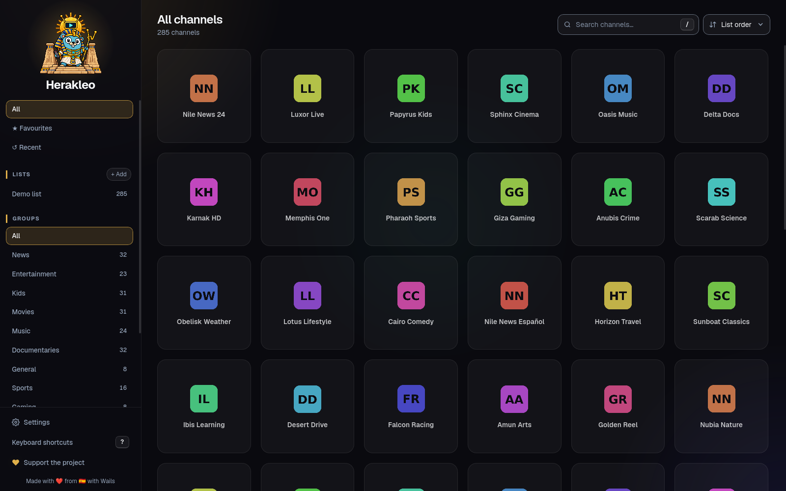

<p align="center">
  
</p>

<h1 align="center">Herakleo</h1>

<p align="center"><i>Named after Herakleopolis, the ancient Egyptian city that stood up to Thebes.</i></p>

<p align="center">
  <a href="https://github.com/crstian19/herakleo/releases">
    
  </a>
  <a href="https://github.com/crstian19/herakleo/actions/workflows/ci.yml">
    
  </a>
  
  <a href="LICENSE">
    
  </a>
</p>

<p align="center">A fast, free and open source <b>IPTV player</b> for Linux, Windows and macOS. Open an
<b>M3U / M3U8 playlist</b> or an <b>Xtream Codes</b> account, find a channel among tens of thousands,
and watch it in mpv or VLC.</p>

<p align="center">
  <a href="https://serve.crstian.me/public/herakleo/herakleo-launch.mp4">
    
  </a>
  <br><sub>▶ <a href="https://serve.crstian.me/public/herakleo/herakleo-launch.mp4">Watch the 45-second video</a></sub>
</p>

<p align="center">
  
</p>

## Features

- **M3U and Xtream Codes**: by URL, from a local file, or with an Xtream account (shows its expiry
  date). Several lists at once, each one can be refreshed or turned off without deleting it.
- **Built for big lists**: 65,000 channels search, filter and scroll smoothly. Searching is a
  single pass over a precomputed index and the channel grid only renders what is on screen.
- **Films and series**: Xtream VOD (movies, and series by season and episode) and the films in
  M3U lists, in their own tabs next to live TV.
- **TV guide (EPG)**: what is on now and next on every card, a day and a half of programmes per
  channel, and reminders when a show starts. The XMLTV guide comes from the Xtream panel, the M3U
  header (`url-tvg`) or a URL you add.
- **Plays in your player**: mpv by default; VLC everywhere, Celluloid and Haruna on Linux, IINA
  on macOS. Stream caching, hardware decoding and start volume can be set from the app.
- **Favourites, history and hiding**: hide channels or whole groups you never watch, keep a list of
  recent channels, back up favourites (they survive re-adding a list).
- **Keyboard first**: every view works with arrows, Enter and Esc, so a TV remote is enough. Press
  `?` for the shortcuts.
- **Six languages** (English, Spanish, French, Portuguese, German, Italian), picked from the
  system, and six accent colours.
- **Light on old machines**: visual effects can be turned off, and the grid can page (default) or
  scroll infinitely.
- Everything stays on your machine (the folder is shown in Settings). No accounts; anonymous usage
  statistics you can turn off in one click ([what is sent](#telemetry)).

## Install

Download the package for your system from the
[latest release](https://github.com/crstian19/herakleo/releases/latest). Herakleo plays channels in
an external player, so install one too: [mpv](https://mpv.io) is the default.

| System | File | Notes |
|---|---|---|
| Arch Linux | AUR: [`herakleo-bin`](https://aur.archlinux.org/packages/herakleo-bin) or [`herakleo`](https://aur.archlinux.org/packages/herakleo) (from source) | `paru -S herakleo-bin`, or `sudo pacman -U herakleo-*.pkg.tar.zst` from the release |
| Ubuntu 24.04+, Debian 13+ | `herakleo_*_amd64.deb` | `sudo apt install ./herakleo_*_amd64.deb` |
| Fedora 39+ | `herakleo-*.x86_64.rpm` | `sudo dnf install ./herakleo-*.x86_64.rpm` |
| Any Linux | `herakleo-*.flatpak` | `flatpak install --user herakleo-*.flatpak` (players still come from the system) |
| Windows 10/11 | [Scoop](https://scoop.sh): `scoop bucket add crstian19 https://github.com/crstian19/scoop-bucket` then `scoop install crstian19/herakleo`; or `herakleo-*-setup.exe` / the `.zip` from the release | Unsigned installer: on the SmartScreen warning, click *More info* → *Run anyway* |
| macOS 12+ | [Homebrew](https://brew.sh): `brew install --cask crstian19/tap/herakleo`; or `herakleo-*-macos-universal.dmg` from the release | Unsigned: see below |

Players are found on `PATH` and in their usual install folders (`Program Files` on Windows,
`/Applications` and Homebrew on macOS). On Windows, `scoop install mpv` or the
[mpv builds](https://mpv.io/installation/) work; on macOS, `brew install mpv` or IINA.

**macOS**: the app is not notarized, so the first launch says it cannot be checked. Drag
Herakleo to Applications, then either right-click it → *Open*, or run
`xattr -dr com.apple.quarantine /Applications/Herakleo.app` once.

## Build from source

Requirements on Linux: [Go](https://go.dev) 1.27+, [Bun](https://bun.sh),
[just](https://just.systems), `gtk4`, `webkitgtk-6.0` and `pkgconf`. Windows and macOS builds are
made by the release workflow; its steps work by hand too.

```bash
just setup         # frontend dependencies and git hooks
just build         # → wails/build/bin/herakleo
just dev-wails     # live-reloading development build
just dev-mock      # the UI alone, in a browser, with fake data
just test          # svelte-check and Go tests
```

## How it is built

The UI is Svelte 5 + Tailwind 4, rendered by the system WebKit. The app you install uses a Go
backend on [Wails v3](https://v3.wails.io) (GTK 4).

Herakleo was first written twice, on [Tauri 2](https://v2.tauri.app) and on Wails, to compare
both frameworks on a real app. Wails won: on Linux, Tauri still uses the GTK 3 WebKit, which caps
scrolling at 60 fps, and Wails v3 on GTK 4 does not. The Tauri version was removed after
[v0.1.0](https://github.com/crstian19/herakleo/releases/tag/v0.1.0) and stays in the git history.

```
frontend/          Svelte UI (src/lib/types.ts is the API contract with the backend)
wails/             Go backend (Wails v3): playlist parsing, library, player
packaging/         Linux packages: arch/ (PKGBUILD), aur/, linux/ (desktop file, deb/rpm), flatpak/
scripts/           benchmark and scroll-profiling harnesses
docs/images/       README screenshot
```

## Releases

```bash
just bump 0.2.0    # app version, PKGBUILD pkgver and AppStream entry
git commit -am "chore: release v0.2.0" && git tag v0.2.0 && git push --follow-tags
```

The tag starts [`release.yml`](.github/workflows/release.yml): it builds every package above and
publishes them with a `SHA256SUMS` and release notes built from the commits.
Running the workflow by hand builds the same packages as artifacts without publishing. Windows and
macOS assets (icon, manifest, installer script, `Info.plist`) are in `wails/build/`.

## FAQ

**Does Herakleo include channels?** No. It is only a player: you add your own M3U playlist or the
Xtream Codes account from your provider. Use it with content you have the right to watch.

**Does it play the video itself?** No, it opens each channel in an external player (mpv, VLC,
Celluloid, Haruna or IINA). Those players handle every codec IPTV providers use, and Herakleo stays
small.

**Where are my lists and passwords stored?** Only on your computer, in a file only your user can
read. Settings shows the folder. Herakleo has no accounts. It sends anonymous usage statistics,
which you can turn off (see [Telemetry](#telemetry)).

## Telemetry

To know how many people use Herakleo and on which systems, it sends anonymous usage statistics. They
are on by default; turn them off in **Settings → Privacy**, or set `DO_NOT_TRACK=1` in your
environment, and it sends nothing.

It sends one event a day at most to [Umami](https://umami.is), a privacy-focused analytics tool run
by the author at `umami.crstian.me`. This is all that is stored:

- the Herakleo version, the operating system and architecture, and whether it runs as a Flatpak;
- the desktop language (e.g. `es-ES`);
- a random install ID, made up on your machine, so that one person opening the app every day counts
  once. Turning statistics off deletes it; turning them on again creates a new one.

It never includes your lists, channels, URLs, accounts or anything you watch. Your IP address reaches
the server like with any web request; Umami uses it for the country and does not store it. The code
is in [`wails/internal/telemetry`](wails/internal/telemetry/telemetry.go).

## Support

Herakleo is a side project. If it is useful to you, you can support it on
[GitHub Sponsors](https://github.com/sponsors/crstian19), [Ko-fi](https://ko-fi.com/crstian) or
[PayPal](https://paypal.me/CrstianG).

## License

[GPL-3.0-or-later](LICENSE). You can use, study, change and share Herakleo; copies and
modified versions you distribute must stay under the same license, with their source.
